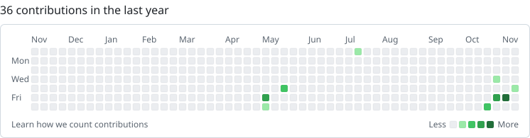

<picture>
  <source media="(prefers-color-scheme: dark)" srcset="https://raw.githubusercontent.com/Yatharth-Jha-Yx/Yatharth-Jha-Yx/output/header-dark.svg">
  
</picture>

I build software that does a lot with a little: computer vision, security tooling, databases, the occasional game. Everything is designed to run well on modest hardware. Based in Mumbai, finishing a Master's in Computer Applications.

 

<table>
  <tr>
    <td><a href="https://github.com/Yatharth-Jha-Yx/Facefolio"><b>Facefolio</b></a></td>
    <td>Sorts photos and videos by who is in them, entirely offline. Face clustering with a local review UI, and corrections that stick.</td>
    <td align="right">Python</td>
  </tr>
  <tr>
    <td><a href="https://github.com/Yatharth-Jha-Yx/Data-Exfiltration-tool"><b>Exfiltration Detector</b></a></td>
    <td>Learns what normal file and network activity looks like on a Windows machine, then flags what isn't. No signatures, no rule lists.</td>
    <td align="right">Python · IsolationForest</td>
  </tr>
  <tr>
    <td><a href="https://github.com/Yatharth-Jha-Yx/LAS-Live-Attendance-System"><b>Live Attendance</b></a></td>
    <td>Attendance taken by a camera instead of a register. Face recognition on live feeds, with a web dashboard.</td>
    <td align="right">Python · OpenCV</td>
  </tr>
  <tr>
    <td><a href="https://github.com/Yatharth-Jha-Yx/LensCraft-Camera-App"><b>LensCraft</b></a></td>
    <td>A native Windows 11 camera app that stays out of the way.</td>
    <td align="right">C# · WinUI 3</td>
  </tr>
  <tr>
    <td><a href="https://github.com/Yatharth-Jha-Yx/ClaimArea"><b>GeoQuest</b></a></td>
    <td>A territory game played on real streets. Walk a loop, claim the land inside it.</td>
    <td align="right">JavaScript · GPS</td>
  </tr>
  <tr>
    <td><a href="https://yatharth-jha-yx.github.io/Art-Showcase-Website-for-Kavita-Jha/"><b>Twelve Rooms</b></a></td>
    <td>An artist's portfolio as a single-page exhibition in twelve rooms.</td>
    <td align="right">HTML · CSS</td>
  </tr>
</table>

 

<picture>
  <source media="(prefers-color-scheme: dark)" srcset="https://raw.githubusercontent.com/Yatharth-Jha-Yx/Yatharth-Jha-Yx/output/github-snake-dark.svg">
  
</picture>

A year of commits, eaten nightly. Redrawn from live data every day.

 
 

<a href="https://www.linkedin.com/in/yatharth2002/">LinkedIn</a> &nbsp;·&nbsp; <a href="https://x.com/YatharthYx">X</a> &nbsp;·&nbsp; Open to collaborating on games, computer vision and tooling.
